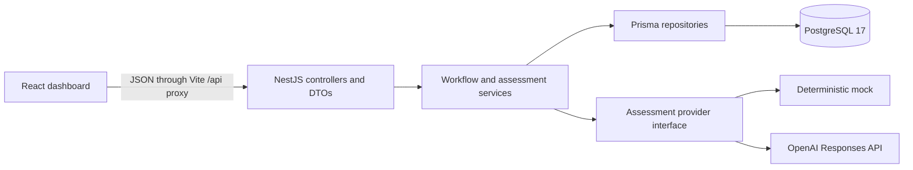

# Technical proposal

## Problem and solution

The business team needs to know whether a clinical study justifies the exact cosmetic claim attached to a tested product formula. A 12% wrinkle reduction after four weeks supports an improvement but leaves a 20% claim unsubstantiated. The application links the claim, manager review, scientist's formula, and evaluator's evidence so the assessment can explain the difference and show the source.

The workflow is proposal → applicability and feasibility review → formula submission → clinical study → assessment. The manager decides whether a claim proceeds. The evaluator's study data informs the separate evidence verdict.

## Architecture



NestJS provides dependency injection and a shared HTTP validation and error boundary. Services own workflow rules, while repositories isolate database access. Prisma types connect application records to PostgreSQL constraints. Provider injection gives the browser and database the same contract in mock and live modes.

## Data design

| Prisma model | Design |
| --- | --- |
| `Claim` | Exact claim wording and `PROPOSED`, `APPROVED`, or `REJECTED` status. The review write and status update are atomic. |
| `ClaimReview` | Applicable and feasible decisions, notes, and timestamp. |
| `Formula` | Claim link, description, and JSON ingredient composition. |
| `ClinicalStudy` | Claim and tested formula links. Stores study details and source excerpts with stable IDs. |
| `Assessment` | Claim, formula, study, required response fields, optional verdict, cited IDs, gaps, provider, and JSON input snapshot. |

Composite foreign keys prevent mismatched claim, formula, and study combinations. SQL checks enforce confidence bounds and supported/verdict consistency. Past evidence and assessments are append-only through the current API.

## API contract

`POST /api/claims/assess` accepts two UUIDs:

```json
{
  "claimId": "10000000-0000-4000-8000-000000000001",
  "clinicalStudyId": "10000000-0000-4000-8000-000000000004"
}
```

A successful write returns HTTP `201` with an ID, `supported` (boolean), `confidence` (number from 0 to 1), `reasoning` (string), verdict, excerpt IDs, evidence gaps, provider, and timestamp. The fictional seed yields `supported: false` and `PARTIALLY_SUPPORTED` because 12% at four weeks falls below the claimed 20%. The React UI displays **Supported: No**, **70%** heuristic confidence, the reasoning and evidence, and saved assessment history.

## Evaluation and persistence

1. Validate UUIDs, find the approved claim and review, and ensure the study and formula belong to that claim.
2. Build the input snapshot from the retrieved claim, formula, and study. Pass it to the selected provider outside any database transaction.
3. In live mode, send data separately from the evaluation instructions and request strict structured JSON. The prompt treats study text as untrusted, compares the reported endpoint, effect, timeframe, population and study design, and asks for explicit gaps. Mock mode applies narrow deterministic rules to the fictional wrinkle-reduction example.
4. Validate types, confidence range, supported/verdict agreement, and citation IDs. Require paraphrases and reject marked quotes. Save the validated result and the input snapshot in one write. Return that saved result and expose it in assessment history.

## Error handling and security

DTO errors return `400`, missing resources `404`, and workflow conflicts `409`. Provider failures or invalid output return `502`, and timeouts return `504`. Provider errors leave assessment history unchanged. Unexpected errors return a generic `500`. Credentials are read from an ignored backend environment file, SDK logging is disabled, and responses omit internal exceptions and prompts. Live mode sends selected study data to OpenAI. The local demo uses fictional data and has no authentication.

## Research and tradeoffs

The NestJS validation guide informed global DTO validation. Prisma's PostgreSQL documentation informed the driver adapter and environment-based connection. OpenAI's Structured Outputs guide informed strict JSON parsing, with application-side evidence checks for constraints that depend on the submitted study. [NestJS validation](https://docs.nestjs.com/techniques/validation) · [Prisma PostgreSQL](https://www.prisma.io/docs/orm/v7/core-concepts/supported-databases/postgresql) · [OpenAI Structured Outputs](https://developers.openai.com/api/docs/guides/structured-outputs?api-mode=responses)

Synchronous evaluation keeps the demo and failure handling straightforward, while slow providers leave the user waiting on one request. The snapshot supports review of a past result, and excerpt-ID checks validate provenance. Determining whether an excerpt supports a generated interpretation remains a human review task.

## Roadmap

1. Build an expert-reviewed evaluation set that covers mismatched endpoints, comparators, and timepoints. Track agreement by claim type and add human approval for high-impact decisions.
2. Add role-based access and audit events. Ingest study documents with excerpt-level provenance and version history.
3. Add background evaluation, idempotency, operational monitoring, and pagination as traffic and study sizes grow.
